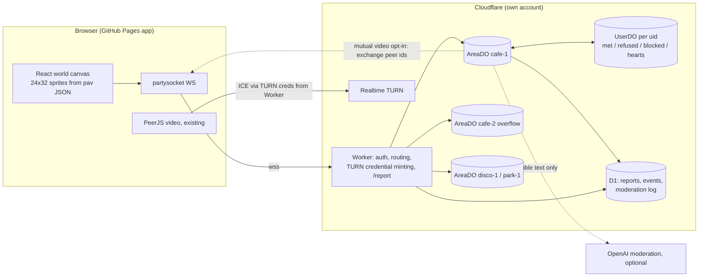

# Pixeldate World: tech research

Status: research only, no code yet. Written 29 Oct 2026. All prices are USD and come from the vendor pages fetched that day (linked inline). **[unverified]** marks anything I couldn't confirm on a primary page. **[assumption]** marks a modelling choice of mine.

## 1. Recommendation (one stack)

**Use Cloudflare Workers with Durable Objects, through PartyServer and `partysocket`. Keep GitHub Pages for the static app. Use Cloudflare Realtime TURN for video dates.**

- **One authoritative Durable Object (DO) per area copy**, e.g. `cafe-1`, `disco-1`, `park-1`, plus `cafe-2` and so on for overflow.
  - Clients send their input at 10 Hz.
  - The DO runs a 10 Hz tick and sends each client **one batched binary snapshot** per tick.
  - The DO enforces blocks, refusals, bubble filtering and rate limits.
  - It computes hearts **server-side**, so a client never receives anyone else's preferences.
- **One `UserDO` per uid** (SQLite) holds met, refused, blocked and hearted lists. A small **D1** database holds reports, the event schedule and the moderation log.
- **Why this one:**
  - Cloudflare bills incoming WebSocket messages at 20:1, outgoing messages are free, and Workers have no egress charge.
  - So the 10 Hz fan-out costs nearly nothing. Every per-message service (Ably, Pusher, Supabase) bills each delivery to each recipient.
  - It is the cheapest option at every scale I modelled (about **$5 / $19 / $35 a month** at 100 / 1k / 10k MAU), runs real server code, and needs no servers to operate.
- **Important:** the hosted PartyKit platform **shut down on 23 Oct 2026**, and `npx partykit deploy` no longer works. New projects use **PartyServer** (same rooms/onConnect/onMessage model), deployed to our own Cloudflare account with `wrangler`. PartyServer works on the Workers free plan. Sources: [shutdown post](https://blog.partykit.io/posts/hosted-platform-shutdown/), [migration guide](https://docs.partykit.io/guides/migrate-to-partyserver/), [cloudflare/partykit](https://github.com/cloudflare/partykit).

## 2. Usage assumptions and the maths

**[assumption]** usage model:

| Input | Value |
|---|---|
| Sessions | 3 a week × 52/12 = **13 a month per MAU**, 30 min each, giving **390 connected minutes = 23,400 s per MAU per month** |
| Average concurrency | MAU × 390 / 43,200 min = 0.9 / 9 / 90 at 100 / 1k / 10k MAU |
| Peak CCU | 5× average for the evening peak, and 2× that for event nights such as the Friday disco. That gives **about 5 / 45 / 450 normal peak and 9 / 90 / 900 event peak** |
| Others in your area (F) | 3 / 13 / 39 at 100 / 1k / 10k MAU (rooms capped at 40 before an overflow copy opens) |
| Update rate | 10 Hz upstream for the whole time a user is connected. This is an upper bound: if the client only sends while moving, upstream roughly halves |
| Wire format | Binary: 8 B per entity (u16 id, u16 x, u16 y, u8 dir, u8 anim) plus about 6 B of WebSocket framing. JSON would be about 5× larger |
| Video | 1 date a month per MAU (MAU/2 calls), 15 min, 1.5 Mbps each way, so 337.5 MB relayed per call. **20% of calls need TURN** [unverified, rule of thumb] |
| Bubbles | 20 per session, so 260 per MAU per month |

**Messages per month.** Upstream is 23,400 s × 10 Hz = **234,000 per MAU**.

| | 100 MAU | 1k MAU | 10k MAU |
|---|---|---|---|
| Upstream (client to server) | 23.4M | 234M | 2.34B |
| **Pure pub/sub** (each update fanned out to F peers; billed as 1 publish + F deliveries) | 93.6M | 3.28B | 93.6B |
| **Server-batched** (1 in + 1 snapshot out per client per tick, so 20/s per client) | 46.8M | 468M | 4.68B |
| Peak message rate, event night, batched / unbatched | 181 / 361 per s | 1.8k / 12.6k per s | 18k / 361k per s |

**Snapshot bandwidth to clients** is (F+1) × 8 + 6 bytes × 10 Hz. That is 38 B, 118 B and 326 B per frame, so 0.4 / 1.2 / 3.3 KB/s per client. Monthly totals are **0.9 / 28 / 763 GB**, before TCP/TLS overhead (very roughly +0.5 KB/s per client, [unverified]).

At the per-client level: a full 40-person room costs about 26 kbit/s down per client in binary, which is fine on 4G. JSON would be about 144 kbit/s, so use binary.

## 3. Options compared

| Option | Fit | Server authority | Free tier | Hard limits that bite |
|---|---|---|---|---|
| **Cloudflare DO + PartyServer** | Excellent. A room per area is the native model | Full: our own JS runs in the room. Can tick, validate, filter and compute hearts | Workers Free: 100k req/day, 13,000 GB-s/day DO duration, SQLite DOs included | 1 DO has a soft limit of 1,000 req/s ([limits](https://developers.cloudflare.com/durable-objects/platform/limits/)), so a 40-person room at 10 Hz uses about 400/s. Cap rooms at 40–50 |
| Supabase Realtime | OK for presence and chat. Poor at 10 Hz | It's a relay: logic runs in Edge Functions, RLS or Postgres. There's no room tick, so no batching | 200 connections, 2M msgs/month, 100 msgs/s, project paused after 1 week of inactivity | Pro: 500 msgs/s, and 2,500 msgs/s with the spend cap off. Presence is 5 calls per client per 30 s ([limits](https://supabase.com/docs/guides/realtime/limits)) |
| Ably | Very good relay, global, reliable | Relay. Logic goes in webhooks or integrations or our own server | 6M msgs/month, 200 connections, 500 msgs/s | Standard: 2,500 msgs/s. Pro: 10k/s ([pricing](https://ably.com/pricing)) |
| Pusher Channels | Relay. Plans are priced per day | Relay, plus webhooks | 200k msgs/day, 100 connections | Largest listed plan is 90M msgs/day ([pricing](https://pusher.com/channels/pricing/)) |
| Colyseus (self-hosted or Cloud) | Excellent. Built for authoritative game rooms (schema deltas, matchmaking, room copies) | Full | OSS free. **Cloud has no free tier** ([FAQ](https://colyseus.io/cloud-managed-hosting/)) | We run a long-lived Node server, and Cloud has no autoscaling. We'd also need a separate database for hearts and blocks |
| Firebase RTDB | Workable for presence, wasteful for 10 Hz | Security rules plus Cloud Functions triggers (which add latency; no tick) | Spark: 100 connections, 10 GB/month download | 1,000 writes/s per database ([limits](https://firebase.google.com/docs/database/usage/limits)). At 10k MAU on event nights that is about 9k writes/s, so you'd shard across databases |

## 4. Cost table (USD/month, realtime layer only)

| Option | 100 MAU | 1k MAU | 10k MAU | How it's computed |
|---|---|---|---|---|
| **Cloudflare DO (recommended)** | **$0** on Free (about 39k req/day, about 10k GB-s/day), or **$5.15** on Paid | **$19.15** | **$35.05** | $5 Workers Paid minimum. **Requests:** upstream ÷ 20 + connects = 1.17M / 11.7M / 117M, with 1M included, then $0.15/M. **Duration:** room-hours [assumption: 650 / 1,000 / 2,500 h] × 3,600 × 0.128 GB = 0.30M / 0.46M / 1.15M GB-s, with 400k included, then $12.50 per 1M (rounded up to the next 1M). Egress is free. Even if room-hours doubled at 10k, the total would only be about $48 |
| Supabase Realtime (Pro), batched via a server | $130 | ~$1,183 | ~$11,722 plus Enterprise (18k msgs/s exceeds Pro's 2,500) | $25 + (msgs − 5M) × $2.50/M, then +$10 per 1k connections over 500 at 10k |
| Supabase Realtime, pure broadcast | $248 | ~$8,200 | ~$234k (not feasible) | Same formula |
| Ably, batched | $146 | ~$1,199 | ~$11.7k list price plus Enterprise (rate) | $29 Standard + $2.50/M. Volume discounts go down to $0.50/M, but the tier break-points are [unverified]. Connection-minutes add $0.04 / $0.39 / $3.90 |
| Ably, pure pub/sub | $263 | ~$8,219 | ~$234k (not feasible) | |
| Pusher, pure pub/sub | $99 (3.1M/day) | 109M/day exceeds the top listed plan, so Enterprise (price not shown) | Not priced | Per-day plan bands |
| Pusher, batched | $99 | $499 (15.6M/day) | 156M/day, so Enterprise (price not shown) | |
| Firebase RTDB | about $0 (7 GB, under 10 GB) | ~$294 | ~$9.1k plus multi-database sharding | (upstream × F × **100 B per event [unverified]**) − 10 GB, × $1/GB. Bytes billed include protocol overhead, which I didn't verify exactly |
| Colyseus self-hosted | €5.99–6.49 (1 small VPS) + database | same | Probably 2 VPS + database + LB | Hetzner "starting from" prices ([hetzner.com/cloud](https://www.hetzner.com/cloud/)). VPS specs and included traffic [unverified]. Colyseus says 1 vCPU / 1 GB handles about 1–2k simple connections ([FAQ](https://docs.colyseus.io/faq)). Excludes ops time |
| Colyseus Cloud | from $15 + database | from $15 + database | Multiple instances [unverified] | "Starting at $15/mo", no CCU or bandwidth limits ([pricing](https://colyseus.io/pricing/)). Tier specs per instance [unverified]: the simulator didn't render |

Batching on Supabase, Ably or Pusher still needs our own server to run the tick. Once you have that server, the relay adds nothing but cost.

**Add-ons on the recommended stack:**

| | 100 MAU | 1k MAU | 10k MAU |
|---|---|---|---|
| TURN relay (GB) | 3.4 | 34 | 338 |
| **Cloudflare TURN** | **$0** | **$0** | **$0** (under the 1,000 GB/month free allowance, then $0.05/GB) |
| Twilio NTS (Europe $0.40/GB) | $1.35 | $13.50 | $135 |
| Metered (current provider; bills ingress + egress, about 2× GB) | $99 (free tier 500 MB is exceeded) | $99 | ~$234 ($199 for 500 GB + $0.20/GB) |
| Bubble moderation calls | 26k | 260k | 2.6M |
| OpenAI omni-moderation | $0 | $0 | $0 |
| Azure AI Content Safety (alternative) | $9.75 | $97.50 | $975 ($0.375 per 1k records, **from a third-party summary [unverified on Azure]**) |
| D1 / SQLite storage (hearts, blocks, reports) | ~$0 | ~$0 | ~$0 (within the 5 GB and 50M rows written/month included [assumption: low write volume]) |

**Headline total on the recommended stack: about $0–5 / $19 / $35 a month at 100 / 1k / 10k MAU, plus $0 for TURN and moderation.** Not included: Workers Logs, whose pricing changes on 1 Dec 2026 [unverified impact]; a domain; and an age-assurance vendor (see §7).

Sources: [DO pricing](https://developers.cloudflare.com/durable-objects/platform/pricing/), [Workers pricing](https://developers.cloudflare.com/workers/platform/pricing/), [Supabase pricing](https://supabase.com/pricing), [Supabase message counting](https://supabase.com/docs/guides/platform/manage-your-usage/realtime-messages), [Ably pricing](https://ably.com/pricing) and [docs](https://ably.com/docs/pricing), [Pusher](https://pusher.com/channels/pricing/), [Firebase](https://firebase.google.com/pricing), [Cloudflare Realtime pricing](https://developers.cloudflare.com/realtime/pricing/), [Cloudflare TURN](https://developers.cloudflare.com/realtime/turn/), [Twilio NTS](https://www.twilio.com/en-us/stun-turn/pricing), [Metered](https://www.metered.ca/stun-turn), [OpenAI moderation](https://platform.openai.com/docs/guides/moderation).

## 5. Architecture sketch

**Message flow:**
- The client sends `{x, y, dir}` at 10 Hz.
- The AreaDO clamps the speed and checks walls, so clients can't teleport.
- Each tick, the AreaDO sends each client its own snapshot. That snapshot:
  - leaves out anyone either side has blocked;
  - marks refused users "faded";
  - carries a per-viewer heart bit, computed from `br`, `min/max`, `iam/seek` and "not met".
- Bubbles go through a rate limit, then `obscenity`, then (optionally) OpenAI, and are then broadcast. They're kept in memory for a short time and logged to D1 with the report ID only when reported.

**Privacy:**
- Only `PeerProfile` fields (age bracket, not exact age) and the `pav` options JSON (about 240 B) are sent.
- No image data is sent, so the rule that the photo never leaves the phone still holds.
- Video stays P2P (or relayed through TURN, which can't read the encrypted media).

**Areas** are separate DOs joined by "doors". Walking through a door closes one socket and opens another (or multiplexes one socket). A connected-map illusion is enough for phase 1.

## 6. Bubble moderation

- **Server-side filter (always on, free):** [`obscenity`](https://www.npmjs.com/package/obscenity) (MIT, v0.4.6, updated Jan 2026). It catches leet-speak and Unicode-confusable variants, supports an allow-list, and runs inside the DO. `leo-profanity` is a lighter alternative: I didn't check its licence or recent activity [unverified].
- **Add our own rules:**
  - Block phone numbers, emails, @handles and URLs in bubbles. This is the main romance-fraud and off-platform lure vector.
  - Length cap: 80 characters.
  - Rate limit: for example 1 bubble per 3 s and 15 a minute per user, with a cooldown on repeat hits.
- **Hosted classifier (optional):** OpenAI `omni-moderation-latest` is "free to use" per its docs. It gives harassment, hate, sexual and sexual/minors categories, among others. It adds a network hop: either run it asynchronously and retract the bubble afterwards, or hold the bubble for about 300 ms.
  - Under UK GDPR, it's another processor, so it needs to go in the privacy notice. Retention terms [unverified].
  - **Don't use Google Perspective:** it ends on **31 Dec 2026** and stopped taking new usage requests in Feb 2026 ([perspectiveapi.com](https://www.perspectiveapi.com/)).
- **Tools for users:** tap an avatar to Report (reason, plus the last N bubbles attached on the server) or Block. Blocking takes effect server-side immediately and hides both ways.

## 7. Video dates

- **Opt-in flow:** A taps "video?" on B; B taps "video?" on A. The AreaDO sees the match and sends each of them the other's ephemeral PeerJS id. The existing PeerJS P2P flow then takes over. Either side can cancel before the call connects.
- **TURN:** the app currently uses Metered, with its key in `VITE_METERED_KEY`. Vite inlines `VITE_*` values into the public bundle, so anyone can read that key and use our TURN quota.
  - Move to **Cloudflare TURN**, with short-lived credentials minted by the Worker. It costs $0.05/GB after 1,000 GB/month free, shared with the SFU. That comes to $0 at all three scales.
  - Twilio is the fallback at $0.40/GB (Europe).
- **Signalling dependency:** PeerJS's public signalling server is still a third-party dependency. Later, the DO could do signalling itself (it already has both sockets).

## 8. Online Safety Act: main duties (not legal advice)

Pixeldate is a user-to-user service with UK links, so it is in scope. Ofcom's dating guidance ([Ofcom, 18 May 2026](https://www.ofcom.org.uk/online-safety/illegal-and-harmful-content/dating-and-social-discovery-know-the-online-safety-risks-rules-and-how-to-comply)) singles out **fraud, intimate image abuse and sextortion, and harassment and stalking**, including users making fake profiles to keep contacting people after being blocked.

- **Illegal content risk assessment:**
  - You have 3 months after launch to do it, and you must repeat it **before any significant change**. The world plus public bubbles plus video is a significant change.
  - Each of the **17 kinds of priority illegal content** must be assessed separately, and you must keep written records ([Ofcom illegal content duties](https://www.ofcom.org.uk/online-safety/illegal-and-harmful-content/illegal-content-duties-under-the-online-safety-act); [OSA s.9](https://www.legislation.gov.uk/ukpga/2023/50/part/3/chapter/2/crossheading/illegal-content-duties-for-usertouser-services)).
- **Safety duties:**
  - Take proportionate steps to prevent users encountering illegal content, and remove it swiftly.
  - Explain how you do this in the terms of service.
  - Provide **easy reporting and a complaints procedure**.
  - Keep records of the Codes measures you've adopted, or of the alternatives you used instead.
  - The current [Illegal content Codes for U2U](https://www.ofcom.org.uk/online-safety/illegal-and-harmful-content/online-safety-regulatory-documents) are the version in force from 30 Sep 2026. A further amended version was **issued 12 Oct 2026** and takes effect 21 days after issue, so check what it changes.
- **Children:**
  - You must do a children's access assessment.
  - If the service permits pornographic content (including user-generated), Ofcom says dating services must use **highly effective age assurance**, in profiles and in DMs. Self-declaration does not count ([HEAA guidance](https://www.ofcom.org.uk/siteassets/resources/documents/consultations/category-1-10-weeks/statement-age-assurance-and-childrens-access/part-3-guidance-on-highly-effective-age-assurance.pdf?v=395680)).
  - Today Pixeldate only self-declares a birth month/year. This is the biggest open compliance question: it decides whether we need a paid age-assurance vendor (cost [unverified]), and it conflicts with "exact age never leaves the device".
  - Dates for children's duties not re-verified this round [unverified].
- **Women and girls guidance:** Ofcom lists safer defaults, reducing gender-based-harm content and better reporting (trusted flaggers, off-platform incident reports) as recommended actions for dating platforms.
- **What this means for the design:**
  - Server-side blocks that survive a new uid. That needs some account binding: phase 1 can use invite tokens, and later email or passkey.
  - A report button on every avatar and bubble.
  - Moderation logs kept (D1).
  - Clear terms of service.
  - Bubble filter on by default.
  - The video date requires mutual opt-in.
  - Do the written risk assessment **before** the hidden link is shared beyond testers.

## 9. Phased plan

1. **Phase 1: café only, behind a hidden link (no video).**
   - One Worker and an AreaDO class (PartyServer), plus a UserDO (SQLite). Workers Free is enough at first.
   - Join with an invite token and the existing `PeerProfile` + `pav`.
   - Server-side movement (10 Hz input, 10 Hz binary snapshots), presence, and a cap of 40 people with automatic `cafe-2` overflow.
   - Hearts computed server-side: fit plus not-met. Refused users fade; blocked users are hidden both ways.
   - Bubbles: rate limit, `obscenity`, a contact-info regex, and a report/block menu. D1 for reports.
   - Load-test with headless bots (40 per room) and check per-DO request rate and duration in the dashboard.
   - Write the OSA risk assessment record.
2. **Phase 2: map and video.** Add the disco and park DOs plus doors. Mutual video opt-in hands off to PeerJS. Cloudflare TURN credentials come from the Worker, and the Metered key is removed from the bundle. Optionally add the OpenAI moderation pass.
3. **Phase 3: events.** A scheduled Friday disco using a DO alarm and an event table in D1, an RSVP flag, pre-warmed overflow copies, and an event-night load test at the 2× peak.
4. **Phase 4: hardening.** Account binding against block evasion, the age-assurance decision, an admin review queue for reports, and abuse metrics. Possibly move PeerJS signalling into the DO.

## 10. Risks

- **Usage model:** the costs depend on my assumptions (13 sessions a month, 5× peak, F, room-hours). Re-run the table with real numbers after phase 1. The DO cost is dominated by **room-hours**, not users, so idle-room shutdown matters: drop the tick when a room is empty.
- **DO limits:** single-object throughput is a soft 1,000 req/s. Keep rooms ≤ 40–50 at 10 Hz, or drop to 5 Hz input plus interpolation.
- **Vendor concentration:** PartyKit's hosted platform was just shut down. PartyServer is maintained by Cloudflare and is open source, but it is a thin library, so lock-in is mainly to Durable Objects themselves.
- **Moderation gaps:** word filters are easy to evade and produce false positives. User reports and a human review loop are still required. The hosted classifier adds latency and a data processor.
- **Block evasion and fake profiles:** these are explicitly called out by Ofcom, and local random uids make them trivial today.
- **Age assurance:** HEAA may be required, depending on the content policy and the children's access assessment. That has a cost and a privacy trade-off.
- **The current TURN key is public** (it's a `VITE_` variable in the bundle). Fix this in phase 2, or sooner.
- **Unverified items:** Colyseus Cloud tier specs; Ably volume-discount break-points; Pusher Enterprise pricing; Firebase bytes per event; Hetzner specs and included traffic; Azure price (third-party source); the share of calls needing TURN; `leo-profanity` licence; the children's-duty dates; and Workers Logs pricing from 1 Dec 2026.

## 11. Age assurance

*Researched 29 Oct 2026 (UK time). This is not legal advice. Prices are the vendors' own published figures, read on 29 Oct 2026, unless marked **unverified**. Nothing here was signed up for or contacted.*

### 11.1 What Ofcom says

- **Why it matters for Pixeldate.** Every user-to-user ("Part 3") service has to do a children's access assessment. Ofcom expects most services to conclude that children are likely to access them, *unless they already use highly effective age assurance (HEAA) and can evidence it*. Services that allow pornography (and self-harm, suicide or eating-disorder content) must use HEAA. A dating site with open video and chat between strangers should plan on HEAA before the shared world opens to the public. Sources: [Age checks to protect children online](https://www.ofcom.org.uk/online-safety/protecting-children/age-checks-to-protect-children-online), [Online age checks now in force](https://www.ofcom.org.uk/online-safety/protecting-children/online-age-checks-must-be-in-force-from-tomorrow).
- **Methods Ofcom says are capable of being highly effective at 18.** These are listed on [Age assurance duties under the OSA](https://www.ofcom.org.uk/online-safety/protecting-children/age-assurance) and described in [Part 3 HEAA guidance](https://www.ofcom.org.uk/siteassets/resources/documents/consultations/category-1-10-weeks/statement-age-assurance-and-childrens-access/part-3-guidance-on-highly-effective-age-assurance.pdf?v=395680) §3.7–3.13:
  - **Open banking.** The bank confirms over 18 or not, with the user's consent. The date of birth is not shared.
  - **Photo-ID matching.** An uploaded ID is compared with a live image of the user.
  - **Facial age estimation.**
  - **Mobile network operator (MNO) checks.** These rely on whether the network's adult content filter has been lifted on the account.
  - **Credit card checks.** The card issuer approves the card, and card issuers must check the holder is 18 or over.
  - **Email-based age estimation.** This looks at where the email address has been used, for example with mortgage lenders.
  - **Digital identity services and wallets**, including reusable age tokens.
- **Not acceptable** (guidance §3.14–3.16, and the [HEAA FAQ](https://www.ofcom.org.uk/siteassets/resources/documents/online-safety/enforcement/highly-effective-age-assurance--frequently-asked-questions-faq.pdf?v=393828)):
  - Self-declaration. This includes a date-of-birth field with no other evidence and **"tick a box to confirm you're 18+"**.
  - Debit cards or any other payment method that doesn't require the holder to be 18.
  - Terms of service, disclaimers and content warnings.
  - **So the 18+ toggle and birthday in commit 51cbe05 are good UX and copy, but they are *not* age assurance.** They must stay in front of a real check, not replace it.
- **The four criteria** (guidance §4): the method must be technically accurate, robust, reliable and fair.
  - For estimation methods, Ofcom expects a **challenge age**. For example, anyone estimated under 25 does a second check by another method (§4.16–4.20).
  - **Liveness detection** against photos, masks and replays supports robustness (§4.33–4.34).
  - The guidance also points to the ICO's data minimisation rules. Ofcom does not approve or recommend providers (FAQ).

### 11.2 Providers (no ID upload, web-integrable)

| Provider | No-ID methods | UK / Ofcom positioning | Web integration and server-side check | Privacy | Published price |
|---|---|---|---|---|---|
| **Yoti** | Facial estimation, Digital ID app, email, mobile, credit card, database ([developers.yoti.com](https://developers.yoti.com/age-verification/age-estimation)) | Says Ofcom approved facial estimation as a high-assurance method ([blog](https://www.yoti.com/blog/under-the-hood-of-facial-age-estimation/)). PAS 1296 / ACCS certified. | `POST age.yoti.com/api/v1/sessions`, redirect the user to `age.yoti.com?sessionId=…`, then `GET /sessions/{id}/result` from the server, or use webhooks. OVER/UNDER thresholds, so the exact age is not returned by default. | Selfie leaves the device, then is "immediately and permanently deleted". The platform gets yes/no only. | **Quote only** ([support](https://support.yoti.com/yotisupport/s/article/How-much-do-Yoti-identity-checks-cost)). In 2023 Yoti's CEO said £0.25/check, falling "well below £0.10" with volume ([LinkedIn](https://www.linkedin.com/posts/robin-tombs-6928195_ageassurance-ageverification-ageestimation-activity-7110672600330063872-WzMN)): **unverified/old**. A £250 setup fee and £150/month per brand theme support are reported from Yoti's terms by a competitor ([agemin](https://agemin.com/compare/agemin-vs-yoti)): **unverified**. |
| **VerifyMy** | Email-based estimation (OTP proves the user owns the address), facial estimation, credit card, mobile ([verifymy.io](https://verifymy.io/)) | Email method certified to PAS 1296 EAL 3 by ACCS ([white paper](https://verifymy.io/wp-content/uploads/2024/11/Verifymy-White-Paper-Innovative-age-assurance-Email-address-as-the-new-benchmark-for-frictionless-age-estimation.pdf)) | REST API plus hosted flow | Email method needs no camera and doesn't read the inbox. Face maps deleted once the check is complete; other data kept up to 28 days (per its privacy policy, as quoted by agemin): **unverified** | **Quote only.** A third party reports £1.00 per successful check, falling to £0.80 above 40k/month, with exclusivity and a 12-month term ([owlwebmasters](https://owlwebmasters.com/fr/services/verifymy/)): **unverified** |
| **Privately (FaceAssure)** | Facial and voice estimation **on the device**; NFC ID as an option ([privately.eu](https://www.privately.eu/solutions/online-age-verification)) | Markets "anonymous and compliant". No UK certification checked this turn. | iframe or redirect. Result is a **signed JWT** (`rtb=redirect|message`) that the server verifies ([docs](https://documentation.privately.eu/articles/faceassure-browser-gettingstarted)). The demo returns Allow / "Needs Additional Verification" (18–24) / deny ([dev](https://developer.privately.eu/static/web/getting_started.html)). | **Image never leaves the browser.** Only the result plus anonymous diagnostics are sent ([FAQ](https://age-estimation.info/markdown/faq.md)). | **Quote only** |
| **Incode** | Facial estimation, with an **on-device** mode (WASM) ([use case](https://www.incode.com/use-cases/on-device-age-estimation)) | Enterprise. No UK-specific claim checked. | Web SDK 2.x with an opt-in `onDeviceFaceResultsSubmissionEnabled`, which needs end-to-end encryption provisioned for the account ([dev hub](https://developer.incode.com/sdk-reference/web-sdk-2-on-device-face-capture/)) | On-device mode: no image leaves the device. The default mode uploads the image, encrypted. | **Quote only** ([FAQ](https://www.incode.com/faq/)) |
| **Persona** | Selfie age estimation. Its "Age 18+ United Kingdom" Relay claim picks between facial estimation and document + selfie ([help](https://help.withpersona.com/articles/7qr5XFuzcdFKXLAjiZRszz/)) | "Informed by Ofcom guidance". ACCS Level 3 for facial estimation. | Hosted flow / SDK, result redeemed server-side | Cloud processing: the selfie is uploaded ([help](https://help.withpersona.com/articles/45UrKCZtpwW5Z7DJ0JW0vM/)). Retention can be configured. | Essential plan **from $250/month with a 12-month minimum**. Per-check price is **quote only** ([pricing](https://withpersona.com/pricing)). There is a startup programme with some free monthly usage. |
| **Luciditi** | Facial estimation, MNO, digital ID (Age Proof app), document ([luciditi.co.uk](https://luciditi.co.uk/age-assurance/)) | Certified under the UK digital identity trust framework (DIATF / DVS) ([ageproof](https://ageproof.luciditi.co.uk/)). Says every method offered is "Highly Effective". | SDK (annual API licence) or WordPress plugin | Says it is privacy-preserving. Not checked further. | **Quote only.** A usage-based annual subscription; no charge unless the user clicks start ([WP page](https://luciditi.co.uk/ageassurance-wp/)). The G-Cloud listing showed £12,544 per licence per year, but the link now returns 404, so treat this as **unverified** ([Digital Marketplace](https://www.applytosupply.digitalmarketplace.service.gov.uk/g-cloud/services/695459167866072)). |
| **AgeChecked** | Checks against "national permissioned data sets"; other methods not verified this turn | PAS 1296; aimed at retail (vapes, alcohol, knives) | REST API, Shopify and WooCommerce plugins | Not checked | Published prices are **plugin only**: WooCommerce from £40/month for 100 checks ([page](https://www.agechecked.com/woocommerce-plugin/)); Shopify credit packs $45/100 down to $300/1,000 ($0.45–0.30) ([page](https://www.agechecked.com/shopify-age-verification/)). The API for a web app is **quote only**. |
| **OneID** | **MNO** (phone number + OTP, about 76m UK users) and **UK open banking** (about 50m), eIDs, reusable OneID wallet ([docs](https://docs.oneid.uk/services/age-verification)) | Certified under the UK DIATF | API. Returns an over-18 true/false plus name (the name could be scoped out, to be confirmed). | No camera and no image. Only a yes/no attribute is shared, with consent. | Self-service price tool with a minimum monthly commitment; custom above 1,000/month ([pricing](https://oneid.uk/pricing)). Per-check figure: **quote only** (the tool's number wasn't captured). |
| **Didit** *(added)* | Selfie age estimation with passive liveness. Borderline cases can fall back to an ID check automatically. | "Aligns with UK OSA". No UK ACCS certification found. | Hosted session (`POST /v3/session/`) plus **HMAC-signed webhooks**, or a server-to-server endpoint ([product](https://didit.me/products/age-estimation/)) | Selfie goes to Didit (EU, AWS). **Default retention is indefinite**, configurable to 30 days or more, so it must be set short. | **$0.10/check**; ID fallback $0.15. From **1 Nov 2026** there is $10 of free credit a month ([pricing post](https://didit.me/blog/new-pricing-november-2026/)). |
| **Agemin** *(added)* | Selfie and email estimation, Challenge-25 option, ID fallback | ISO 27001 / SOC 2. No UK ACCS certification found. | JavaScript SDK (modal or redirect), REST API, webhooks | Says it doesn't store face images | Free: 100/month. Core: $99/month minimum at $0.084/check **+ $0.16 liveness**. Forensic: $599/month minimum at $0.024 + $0.16 ([pricing](https://agemin.com/pricing)). |

### 11.3 Cost per month (one check per new user)

These are list prices in the vendors' own currencies, excluding VAT and retries. Liveness is included wherever it's charged separately, because Ofcom's robustness criterion effectively needs it.

| Provider | 100 users | 1,000 users | 10,000 users | Basis |
|---|---|---|---|---|
| Didit | **$0** (inside the $10 credit) | **$90** | **$990** | $0.10 minus $10 credit. Add $0.15 for each borderline ID fallback, e.g. +$150 at 10k if 10% fall back. |
| Agemin | **$0** (free tier) | **$244** | **$2,440** Core / **$1,840** Forensic | $0.084 or $0.024 + $0.16 liveness, above the monthly minimums |
| AgeChecked | **£40** (WooCommerce plugin plan) | ~$300 *(Shopify 1,000-credit pack; plugin pricing only)* | quote | Web-app API is quote only |
| Yoti | ~£25 **unverified** | ~£250 **unverified** | ≤£2,500, likely lower **unverified** | 2023 CEO figure of £0.25, not a current price list |
| VerifyMy | ~£100 **unverified** | ~£1,000 **unverified** | ~£8,000–10,000 **unverified** | Third-party-reported £1.00–0.80 per success, with exclusivity |
| Persona | ≥$250 | ≥$250 + per-check | ≥$250 + per-check | Platform minimum only (12-month term) |
| Privately, Incode, Luciditi, OneID | quote | quote | quote | No public per-check price |

### 11.4 Recommendation

- **Primary: on-device facial age estimation with liveness, and a challenge age of 25.** Users estimated at 25 or over pass straight away.
  - **First choice: Privately FaceAssure.** The image never leaves the browser, which matches Pixeldate's "the photo never leaves the phone" promise. It returns a signed JWT that a Cloudflare Worker can verify.
  - **Enterprise alternative: Incode's on-device mode.**
  - **If both quotes are too high:** Yoti (strongest UK and Ofcom evidence; the image is deleted on its servers), or Didit (cheapest published price, $0.10). With Didit the image is uploaded, so set retention to the 30-day minimum.
- **Fallback, for under-25 estimates, no camera, or users who refuse: OneID MNO or open-banking check.** It needs no image and no ID, and returns only over-18 yes/no. Email-based estimation (VerifyMy, or Agemin's email method) is a lighter fallback.
- **Last resort:** photo-ID matching through the same vendor.
- **Architecture:**
  - The client runs the vendor flow. The Worker checks the result itself (JWT signature, vendor result API, or HMAC webhook).
  - The Worker stores only `{uid, over18:true, method, vendor tx id, checked_at}`. Keep this for Ofcom record-keeping and an appeals route. No images and no exact age are stored.
  - It then issues a short-lived signed "18+ verified" token. Lobby and world joins require it, and the peer `hello` check can carry it.
  - The current toggle and birthday stay in place as UX, in front of the check.
- **Budget for planning:** about **$0 / $90 / $990 a month** at 100 / 1,000 / 10,000 new users on Didit's list price. Budget about 2–3× that for a privacy-first on-device vendor until quotes arrive (assumption). Fallback MNO or bank checks cost extra for the under-25 share.
- **Next steps:**
  - Ask Privately, Yoti and OneID for quotes. Give them volumes (100 / 1,000 / 10,000 a month), the challenge age of 25, and the fact that this is a UK dating site.
  - Ask each vendor for its ACCS or ISO/IEC 27566-1 certificates and its fairness data by age, sex and skin tone.
